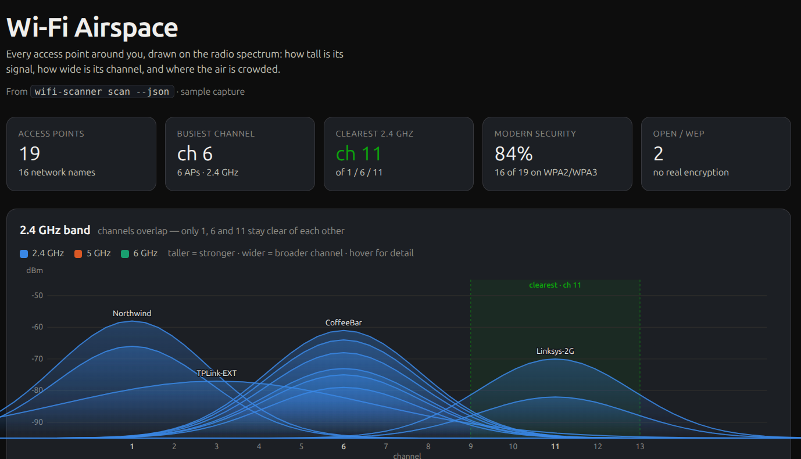

# wifi-scanner

A small Linux tool for **reading and understanding the Wi-Fi around you** — the networks, the airspace, and your own connection. It measures; it does not attack. It never discovers, guesses, or cracks passwords, and it doesn't capture traffic.

```
$ wifi-scanner scan

Nearby Wi-Fi networks:

SSID                             Band    Chan  Width             Signal  Security
Cafe_Guest                       2.4 GHz    6  20MHz  82% (~ -59 dBm)  WPA2
Bakery-5G                        5 GHz    108  80MHz  64% (~ -68 dBm)  WPA2 WPA3
Free_Airport_WiFi                2.4 GHz   11  20MHz  41% (~ -79 dBm)  Open
Office-Staff                     5 GHz     36  80MHz  30% (~ -85 dBm)  WPA2 802.1X
```

## Modes

### `scan` — what's around me
Lists each network once (strongest sighting), with band, channel, width and signal. Writes the names to `lab-ssids.txt` for `bench`. Add `--json` for machine-readable output.

Two kinds of network can be ruled out when you're hunting for the right one:
- **Open** networks don't use a password.
- **802.1X** networks need a username too, so a password alone won't get you on.

### `analyze` — understand the airspace
Turns one scan into a picture: band split, per-channel congestion with a recommended non-overlapping 2.4 GHz channel (1/6/11), a security-posture breakdown, and roaming (one name on several radios). `--json` too.

```
$ wifi-scanner analyze

Bands in use:
  2.4 GHz   17  █████████████████
  5 GHz      8  ████████

Channel use on 2.4 GHz:
  ch  6    6  ██████
  ch 11    2  ██
  → Least-congested 2.4 GHz channel: 1 (of the non-overlapping 1/6/11).

Security posture:
  WPA3 (SAE)   1     WPA2   23     Open   1  ⚠ no encryption
  24 of 25 AP(s) use modern encryption (WPA2/WPA3).

Roaming / multi-AP networks (one name, several radios):
  Campus      2 radios · 2.4 GHz ch8, 5 GHz ch112
```

### `link` — understand my own connection
Reads the active link straight from the driver (`iw`): true dBm, negotiated rate, PHY generation (Wi-Fi 4/5/6/7), channel width, TX power, and retry rate. Answers "why does my connection feel the way it does." `--json` too.

### `monitor` — watch it change over time
Re-scans on an interval and shows each AP's signal as a sparkline, flagging access points that appear or vanish. Good for mapping coverage as you walk or spotting interference.

```
$ wifi-scanner monitor --interval 2
Bakery-5G    5 GHz  108   -62 dBm  ▄▅▅▆▇▆▅  very good
Campus       5 GHz  112   -71 dBm  ▇▆▄▃▂▁   weakening
```

Options: `--interval SECS` (default 3), `--rounds N` (default: until Ctrl-C), `--csv PATH` for a time series.

### Visualize a scan (offline, in your browser)

[](airspace.html)

Open **[`airspace.html`](airspace.html)** — just double-click it; no server, no internet, nothing uploaded. It draws your scan on the radio spectrum: each network as a curve whose height is its signal and whose width is its channel, so crowding and overlap are visible at a glance, alongside a band split, security posture, and roaming view. It opens on a small example capture; paste the output of `wifi-scanner scan --json` into the box to render your own surroundings.

The quickest way to get your scan into the page is the clipboard:

```sh
wifi-scanner scan --json | wl-copy          # Wayland
wifi-scanner scan --json | xclip -sel clip  # X11
```

Then paste into the box and hit **Visualize**. (`scan --json` prints one record per access point, so networks that use several radios show up in the roaming view.)

### `bench` — authorized-lab auth timing
Takes a password **you already know** and times how long each allow-listed network takes to authenticate it. It is consent-gated (type `allow`, or pass `--authorized`), refuses to run against anything outside `lab-ssids.txt`, and finishes by leaving the machine in an honest, documented state. See `wifi-scanner bench --help` territory in the source header for all flags (`--repeats`, `--csv`, `--no-shuffle`, `--leave-disconnected`, `--password-argv`).

> `bench` is only for networks you own or are authorized to administer.

## Requirements

Linux with **NetworkManager** (`nmcli`) — most desktop distributions include it. The `link` and real-dBm parts also use **`iw`** (`sudo apt install iw` / `sudo dnf install iw`); the other modes work without it. Setups without NetworkManager (e.g. `iwd` alone) aren't supported.

## Get it

Build it with [Rust](https://rustup.rs) (no third-party dependencies):

```sh
git clone https://github.com/ru44/wifi-scanner
cd wifi-scanner
cargo build --release
```

A local build lands at `target/release/wifi-scanner`.

## Run it

```sh
./wifi-scanner scan        # or analyze, link, monitor, bench
```

You may need `chmod +x wifi-scanner-linux-x86_64` on a downloaded binary.

## License

[MIT](LICENSE)
